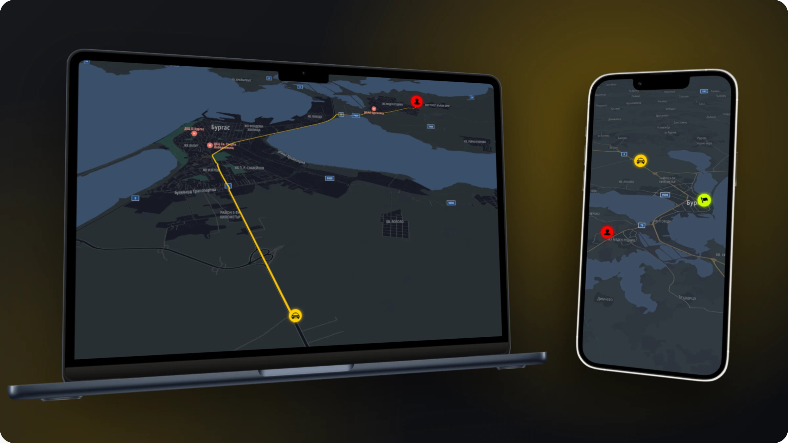
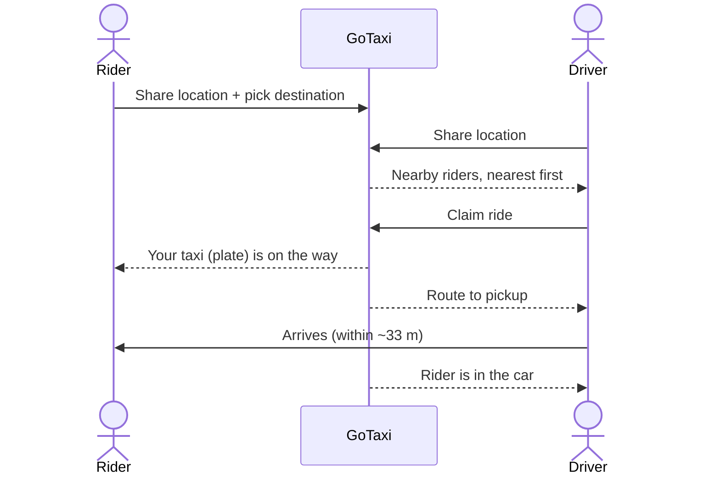
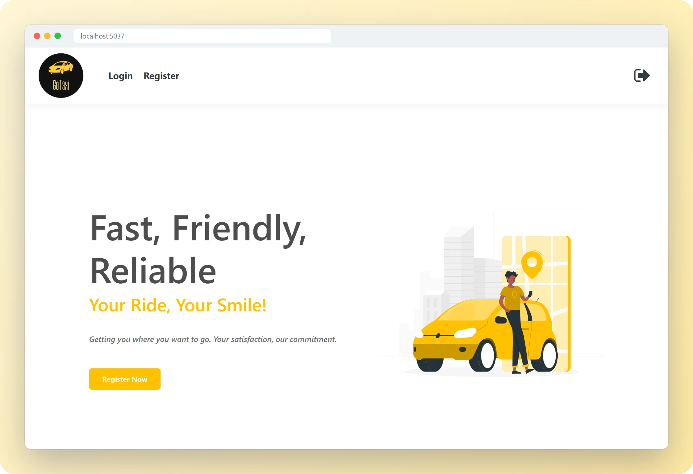
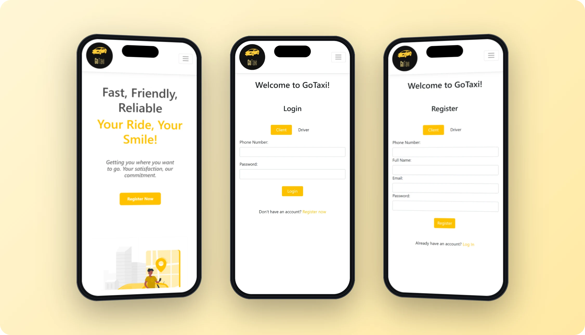
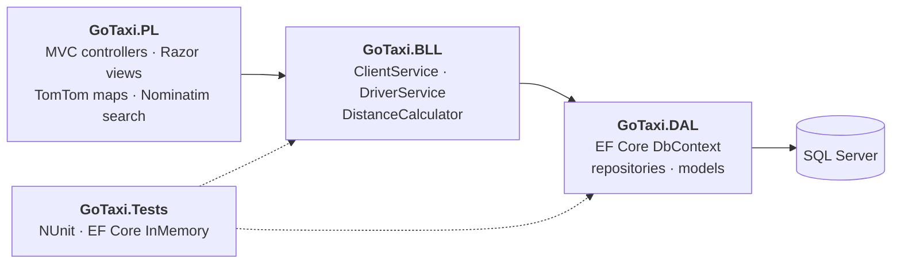

<div align="center">

# 🚕 GoTaxi

**A ride-hailing web app that connects riders with nearby taxi drivers in real time.**<br>
Riders share their location and pick a destination; drivers see waiting riders on a live map, claim a ride and follow the route to the pickup.

<p>


</p>

<a href="#features"><b>Features</b></a> ·
<a href="#how-it-works"><b>How it works</b></a> ·
<a href="#screenshots"><b>Screenshots</b></a> ·
<a href="#architecture"><b>Architecture</b></a> ·
<a href="#getting-started"><b>Getting started</b></a>

<br><br>



</div>

## Overview

GoTaxi has two sides. **Riders** sign in with their phone number, share their location and search for a destination. **Drivers** sign in with their plate number and see every waiting rider nearby on a dark live map, along with where each rider wants to go. When a driver claims a ride, GoTaxi draws the route to the pickup, tells the rider which taxi is coming, and detects when the rider is in the car.

## Features

<table>
<tr>
<td width="50%" valign="top">

### 🙋 For riders
- Share your live location with one tap
- Destination search with autocomplete, powered by OpenStreetMap's Nominatim
- See which taxi accepted your ride and track it on the map
- Cancel a request at any time

</td>
<td width="50%" valign="top">

### 🚖 For drivers
- Live map of waiting riders and other taxis, nearest first
- Each rider card shows their destination and report count
- Claim a ride and get the driving route to the pickup
- Location refreshes automatically while you drive

</td>
</tr>
<tr>
<td valign="top">

### 📍 Location logic
- Distances calculated with the haversine formula
- Riders and drivers within 60 km are matched
- GoTaxi detects pickup once the driver is within ~33 m of the rider

</td>
<td valign="top">

### 🧪 Quality
- 45 NUnit tests covering services and repositories
- EF Core in-memory database for fast, isolated tests
- Separate presentation, business and data layers

</td>
</tr>
</table>

## How it works



**Map legend**

| Marker | Meaning |
| :-- | :-- |
| 🟡 Yellow | Taxi |
| 🔴 Red | Rider waiting for pickup |
| 🟢 Lime | Rider's destination |

## Screenshots

<p align="center">
  
  <br><sub><b>Landing page</b></sub>
</p>

<p align="center">
  
  <br><sub><b>Fully responsive</b>: landing page, sign-in and registration for riders and drivers</sub>
</p>

## Architecture



| Project | Responsibility |
| :-- | :-- |
| `GoTaxi.PL` | Controllers for riders (`ClientController`) and drivers (`TaxiController`), Razor views, map and location scripts |
| `GoTaxi.BLL` | Matching, claiming and visibility rules behind `IClientService` and `IDriverService`; haversine distance |
| `GoTaxi.DAL` | `GoTaxiDbContext`, `User`, `Client`, `Driver`, `Location` and `Destination` models, repositories |
| `GoTaxi.Tests` | Service and repository tests against an in-memory database |

## Getting started

**Requirements:** [.NET 7 SDK](https://dotnet.microsoft.com/download/dotnet/7.0), SQL Server Express, and a free [TomTom API key](https://developer.tomtom.com/).

```bash
git clone https://github.com/HHChandar20/GoTaxi.git
cd GoTaxi/GoTaxi
```

1. **Map key.** Put your TomTom key in `GoTaxi.PL/wwwroot/js/taxi.js` and `client.js` (the `key:` values).
2. **Database.** The connection string in `GoTaxi.PL/Program.cs` points to `.\SQLEXPRESS`, database `GoTaxiDB`. Create the schema with EF Core migrations:

   ```bash
   dotnet tool install --global dotnet-ef --version 7.0.15
   cd GoTaxi.PL
   dotnet ef migrations add InitialCreate --project ../GoTaxi.DAL
   dotnet ef database update --project ../GoTaxi.DAL
   ```

3. **Run.**

   ```bash
   dotnet run
   ```

Run the tests from the `GoTaxi` folder with `dotnet test`.

## Tech stack

**Backend:** C#, ASP.NET Core 7 MVC, Entity Framework Core, SQL Server<br>
**Frontend:** Razor views, Bootstrap, JavaScript, TomTom Maps SDK (maps and routing), Nominatim geocoding, browser Geolocation API<br>
**Testing:** NUnit, EF Core InMemory<br>
**Design:** Figma, Photoshop

## License

Released under the [MIT License](LICENSE).

<div align="center">
<br>
<sub>Built by <a href="https://github.com/HHChandar20">Hakan Chandar</a> · 2024</sub>
</div>
